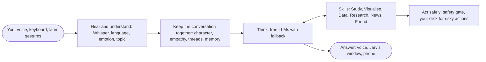

# Jarvis
Ai assistant how deal with emotions of the users'

A voice-first desktop assistant for Sri Lankan students: it talks with you in
English, Sinhala and Singlish, notices how you feel, helps you study and work,
and only acts on your PC in ways it can check and you can undo. A self-study
research project built with free tools only.

## The idea in one picture



Jarvis is **one core plus skills**. The core holds the research:

1. **Emotion-aware replies** in an assistant that actually acts on a
   computer.
2. **Understanding Sinhala and Singlish**, measured, with a consented Sri
   Lankan speech set labelled for emotion, intent and language.
3. **Verified and safe actions:** Jarvis reports what it checked, not what
   it hopes happened, and a misheard word can never confirm a risky action.

The skills are what it helps with day to day, each built on the same safe
tool system.

**Read more:** [how it works](docs/ARCHITECTURE.md) (diagrams, models,
theory) · [roadmap and build order](docs/ROADMAP.md) ·
[implementation plan](docs/IMPLEMENTATION_PLAN.md) (step-by-step build
guide) · [decisions](docs/DECISIONS.md) · [dev log](docs/DEVLOG.md) ·
[languages](docs/LANGUAGES.md) · [measuring speech recognition](eval/README.md)

## Status

**Built:** spoken conversation with push-to-talk, three voices, free LLMs,
the character and empathy modes, the startup greeting, one-click setup, and
the evaluation tools. **Now:** the first run on the laptop (milestone M0).
**Next:** replying in the language you speak, the empathy learner, then
Phase 2 (tools and safety) and the first skill, Study.

## What works now

- **Talk to it**: hold Right Ctrl, speak, let go. Whisper transcribes, a free
  LLM answers, and Jarvis speaks the reply sentence by sentence while the rest
  is still being written.
- **Its own voice and character**: a British Kokoro voice (Lewis) with a light
  studio effects chain, and a written personality in `config/persona.toml`:
  calm, precise, a step ahead, honest, addressing you as "sir" now and then.
  No cloned voices; Jarvis says it's an AI if you ask.
- **Greets like a person**: a time-of-day greeting the first time each day,
  "Welcome back" after a break, just "Yes, sir?" within the same session.
- **Empathy modes**: logical, balanced or supportive. Say "be more direct" or
  "be gentler", or type `/empathy supportive`.
- **Natural timing**: a short "mm, one moment" only when a reply is slow.
- **Three languages**: English, Sinhala, Tamil. "Switch to Tamil",
  "සිංහලෙන් කතා කරන්න", or `/lang si`. Each language has its own speech
  model and voice.
- **Interrupt it**: press push-to-talk while it's speaking (barge-in),
  `Ctrl+Alt+M` to mute replies, `Ctrl+Alt+K` to stop everything.
- **Free LLMs with fallback**: Gemini, Groq (OpenAI's open gpt-oss-20b and
  gpt-oss-120b), OpenRouter (Gemma 4), local Ollama.
- **Measured from day one**: every stage is timed in `logs/`; scripts to
  record test sentences and score Whisper models (WER/CER).

## Coming next

"Hey Jarvis", double-clap and wave to wake it; a Jarvis window with an orb
and your skills around it; calling Jarvis from your phone; a tutor for
physics and maths that gives hints first and checks every result; plots,
data analysis, research with page references, and news on a world map; hand
gestures (open palm to stop, thumbs up or down as feedback, swipes). All
free, private by default, and planned in the [roadmap](docs/ROADMAP.md).

## Setup on Windows

1. **Get the code** into a folder outside OneDrive, on any drive, e.g.
   `D:\Projects\Jarvis`:
   ```powershell
   D:
   cd \Projects
   git clone https://github.com/Adirc7/Jarvis
   ```
   On a drive other than C:, setup offers to keep the big downloads (package
   cache, Python, Whisper and Ollama models) on that drive too, in
   `D:\Projects\.cache`. Jarvis needs roughly 6 GB, plus 2.5 GB with Ollama.
   No Git? Install it with `winget install Git.Git`, or use Code → Download
   ZIP on GitHub (right-click the ZIP → Properties → Unblock, then extract).
2. **Double-click `Setup Jarvis.cmd`** in the Jarvis folder. It:
   - installs uv, which fetches Python 3.12 and every package (the CUDA
     libraries too if it finds an NVIDIA GPU), plus the Visual C++ runtime if
     it's missing;
   - downloads the voices and the hand-tracking model;
   - opens `.env` in Notepad for your free LLM keys: Gemini
     (https://aistudio.google.com/apikey) and Groq (https://console.groq.com/keys);
   - asks about your push-to-talk key (some new laptops have a Copilot key
     where Right Ctrl used to be; then you press the key you want instead);
   - runs the unit tests, creates the shortcuts, and offers a hardware check
     (mic, speakers, camera, GPU, voices).

   The first run downloads a few GB. If a step fails, fix what it says and run
   it again; finished steps are skipped. Options: `"Setup Jarvis.cmd" -NoTamil`
   skips the Tamil voice (about 1 GB of torch), `-NoGpu` skips CUDA.
3. **Double-click Jarvis** on the desktop (or `Start Jarvis.cmd`). Hold the
   push-to-talk key, speak, let go. "Jarvis (text chat)" in the Start menu is
   the typing version.

Optional, for answers without internet: install Ollama from
https://ollama.com and run setup again; it offers to download `qwen3:4b`.

**Update:** `git pull`, then double-click `Setup Jarvis.cmd` again.

**Settings for this computer** (push-to-talk key, audio devices, Whisper
model) go in `config/settings.local.toml`: same format as
`config/settings.toml`, only the lines you change. It isn't committed, so
updates never overwrite it. Change the push-to-talk key any time with
`uv run python scripts/choose_key.py`.

<details>
<summary>Manual setup (what the script does)</summary>

```powershell
powershell -ExecutionPolicy ByPass -c "irm https://astral.sh/uv/install.ps1 | iex"
uv sync --all-extras
uv run python scripts/download_models.py
copy .env.example .env
notepad .env
```
</details>

## Run

```powershell
uv run jarvis --voice                           # talk to Jarvis (hold the push-to-talk key)
uv run jarvis                                   # text chat
uv run python scripts/smoke_test.py --show      # check mic, camera, GPU, models, voices
uv run python scripts/voice_preview.py --play   # hear the candidate voices
uv run pytest                                   # unit tests (no hardware needed)
uv run python -m jarvis.telemetry logs\session-XXXX.jsonl   # latency summary
```

Measuring speech recognition (see `eval/README.md`):

```powershell
uv run python scripts/record_eval_set.py eval/sentences_en.txt --lang en
uv run python scripts/eval_stt.py --lang en --model small --model large-v3-turbo
```

Use **Windows Terminal** for Sinhala and Tamil text; the old console can't draw
these scripts properly.

## Settings worth knowing

Put your own values for `settings.toml` in `config/settings.local.toml` (see
Setup); edit the other files directly.

| File | Setting | What it does |
|---|---|---|
| `config/settings.toml` | `[hotkeys] push_to_talk` | key to hold while speaking (`ctrl_r`, `f9`, ...); `scripts/choose_key.py` sets it |
| | `[stt] model` | Whisper model: `small`, `large-v3-turbo`, ... |
| | `[tts] speed` | `0.9` = slower, calmer voice |
| | `[voice_style]` | the effects chain; `enabled = false` for the raw voice |
| `config/languages.toml` | `tts_voice` | which voice each language uses |
| | `[greeting] same_session_minutes` | talk again within this time and Jarvis carries on without greeting (15) |
| `config/persona.toml` | `address` | how Jarvis addresses you now and then: `"sir"`, your name, or `""` |
| | `user_name` | your name, if you want Jarvis to use it (empty = no name) |
| | `[personality]`, `[speaking_style]` | Jarvis's character; edit freely |
| | `[empathy] default` | starting empathy mode |

## Project layout

```
Setup Jarvis.cmd   one-click setup (runs scripts/setup_windows.ps1)
Start Jarvis.cmd   starts voice mode (runs scripts/run_jarvis.cmd)
config/            settings.toml, languages.toml, persona.toml
                   (+ settings.local.toml: this computer only, not committed)
src/jarvis/
  app.py           request pipeline, voice loop, hotkeys
  persona.py       character sheet -> instructions for the LLM
  greeting.py      greetings that follow sessions, not restarts
  bus.py           event bus (threads -> asyncio queues)
  state.py         shared state + cancel tokens
  language.py      language switching rules
  telemetry.py     JSONL logging, p50/p95 summaries
  agent/llm.py     free providers with fallback
  voice/           capture (push-to-talk), stt (Whisper), tts (Kokoro/Piper/MMS),
                   effects, player, sink (streams replies to speech), text_split
  evaluation/      WER/CER scoring
  perception/ tools/ proactive/ memory/   later phases
scripts/           setup_windows, run_jarvis, choose_key, smoke_test, download_models,
                   voice_preview, record_eval_set, eval_stt
assets/            shortcut icon
eval/              test sentences (recordings stay local)
docs/              ARCHITECTURE.md, ROADMAP.md, IMPLEMENTATION_PLAN.md,
                   DECISIONS.md, LANGUAGES.md, DEVLOG.md
state/, logs/      kept on this computer only (not committed)
```

## Privacy

Audio is only kept while the push-to-talk key is held, and only in memory;
nothing is saved unless you run the evaluation recorder. Free hosted LLM tiers
may use prompts to improve their products, so don't send passwords or private
files through them. Ollama keeps everything on your laptop.

## Licences

Jarvis's own code has no licence chosen yet. Some libraries it uses are
GPL-3.0 (piper-tts, pedalboard), which matters only if you distribute Jarvis
under a different licence. Model licences: Kokoro Apache-2.0, the Sinhala
Piper voice MIT, MMS-TTS CC-BY-NC 4.0 (non-commercial).
