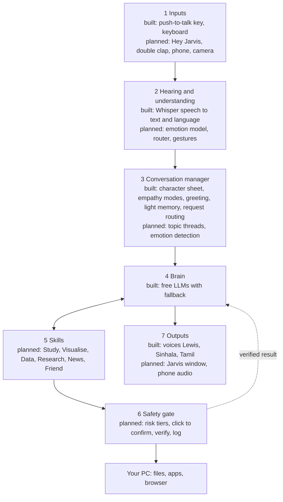
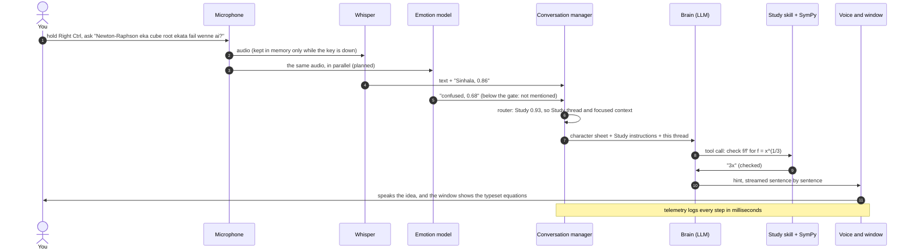
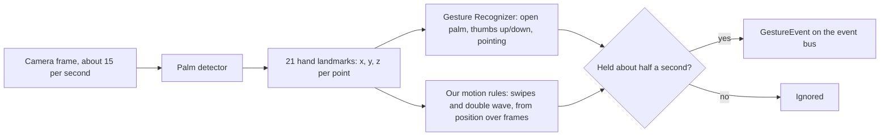
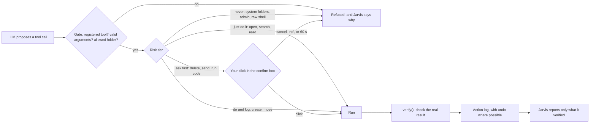
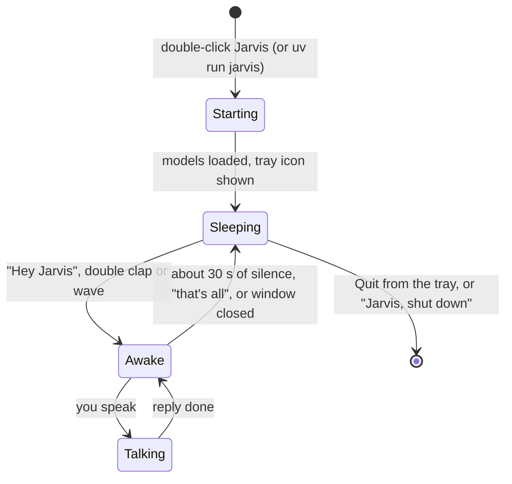

# How Jarvis works

This is the technical picture of the whole system: the parts, how one request
flows through them, how the models talk to each other, how voice, camera and
gestures work, and the theory behind each part. What gets built when is in
[ROADMAP.md](ROADMAP.md); how to build it step by step is in
[IMPLEMENTATION_PLAN.md](IMPLEMENTATION_PLAN.md); why each choice was made is
in [DECISIONS.md](DECISIONS.md).

Status labels: **built** (in the code now), **next**, **planned**, **later**.

## 1. The big picture

Jarvis is **one core plus skills** (D24). The core hears you, understands
you, keeps the conversation together, thinks, acts safely and answers. The
skills are what it helps with. Every request goes down this path and the
answer comes back out at the bottom.

Underneath everything (built): the **event bus**, **cancel tokens and the
kill switch** (Ctrl+Alt+K), **telemetry** (every stage timed), the
**one-click setup** and **per-computer settings**.

## 2. One spoken request, step by step

A study question in Singlish, from your voice to Jarvis's answer. Times are
targets; the logs on the laptop give the real numbers (goal: first audio
under 1.5 s, D8).

## 3. How the models talk to each other

The models never talk to each other directly. Each one turns its input into
a small, plain result; the conversation manager collects those results and
hands them to the LLM as context. The LLM is the only part that reads the
others' outputs, and it answers with either text or a **tool call** (a
small JSON message naming an action and its arguments), which goes through
the safety gate.

| From | What it passes on | To |
|---|---|---|
| Wake word / clap detector | "wake now" | Conversation manager |
| Whisper | text, language, language probability | Conversation manager |
| Emotion model | label and confidence, e.g. `frustrated 0.72` | Conversation manager |
| Gesture recognizer | gesture name, position, confidence | Event bus |
| Router (LLM or small classifier) | skill and confidence | Conversation manager |
| Conversation manager | one prompt: character sheet, mode, skill instructions, active thread, short summaries, emotion and language notes | LLM |
| LLM | reply text, or a tool call `{"tool": "open_file", "args": {...}}` | Voice / safety gate |
| Tool | result plus `verify()` outcome | LLM, action log |
| Text-to-speech | audio, sentence by sentence | Speaker or phone |

**The plumbing (built):**

- **Event bus** (`bus.py`, D4). Microphone, hotkeys and later the camera
  run in their own threads and *publish* typed events
  (`UtteranceCaptured`, `KillSwitchPressed`, `MuteToggled`,
  `LanguageChanged`, `GestureEvent`, ...). The main program runs on asyncio
  and *subscribes*. Each subscriber has its own queue; fast streams like
  gestures drop old events, important ones are never dropped. So a slow LLM
  call never freezes hand tracking.
- **Cancel tokens** (`state.py`, D5). Every long job carries a token. The
  kill switch or barge-in bumps a counter, and every job holding an old
  token stops.
- **Streaming** (D12). LLM words arrive a few at a time; a sentence chunker
  cuts them into sentences; one worker thread turns each sentence into
  audio; the player queues them. Speaking starts after the first sentence,
  not after the whole reply.
- **Fallback** (`agent/llm.py`, D2). Five free LLM entries are tried in
  order (fastest first, as measured on the laptop); the next takes over only before the first word arrives.

**What crosses the internet:** only the prompt text sent to a cloud LLM (and
search queries for skills). Audio, video, landmarks, recordings and files in
private folders stay on the laptop (D7, D25).

## 4. The models

| Job | Model | Runs on | Status | Input, then output |
|---|---|---|---|---|
| Speech to text | Whisper small (faster-whisper, CTranslate2) | Laptop GPU | built | 16 kHz audio, then text and language |
| English voice | Kokoro-82M, voice Lewis | Laptop | built | text, then audio |
| Sinhala voice | Piper si_LK-dilu-medium | Laptop | built | text, then audio |
| Tamil voice | MMS-TTS Tamil (CC-BY-NC) | Laptop | built | text, then audio |
| Brain 1 | gpt-oss-120b on Groq | Cloud, free | built | prompt, then reply or tool call; 0.2 s to first word |
| Brain 2 | gpt-oss-20b on Groq | Cloud, free | built | same; 0.3 s |
| Brain 3 | Gemini Flash | Cloud, free | built | same; slower, sometimes overloaded |
| Brain 4 | OpenRouter free router | Cloud, free | built | same; picks any free model |
| Brain, offline | Qwen3 4B on Ollama | Laptop | built | same |
| Wake word | openWakeWord "hey jarvis" | Laptop CPU | planned | audio frames, then "wake" |
| End of speech | Silero VAD | Laptop CPU | planned | audio frames, then "speech" or "silence" |
| Emotion | emotion2vec or wav2vec2, plus **your classifier** | Laptop GPU | planned | audio, then label and confidence |
| Intent (only if needed) | multilingual encoder plus **your classifier** | Laptop | planned | text, then intent and confidence |
| PDF search | small embedding model | Laptop | planned | text, then vectors |
| Translation test | NLLB-200 600M (CC-BY-NC) | Laptop | planned | Sinhala text, then English |
| Hands | MediaPipe hand landmarker | Laptop CPU | later | video frame, then 21 points per hand |
| Gestures | MediaPipe Gesture Recognizer | Laptop CPU | later | video frame, then gesture name |
| Better Sinhala hearing | **your fine-tuned Whisper** (LoRA) | Laptop GPU | later | audio, then text |

For one reply only three or four run: Whisper, one brain, one voice, and
later the emotion model beside Whisper. The five brains are backups for each
other. Double-clap detection uses no model, only signal processing. On the
6 GB RTX 4050, Whisper and the emotion model fit together; the offline
brain is the big one, so it's for when there's no internet. Hand tracking
and gestures run on the CPU.

## 5. Voice: from sound to text and back

**Hearing (built, plus planned wake-ups).**

1. **When to listen.** Today: hold the push-to-talk key (D13); the
   microphone stream stays open, but frames are kept only while the key is
   down. Planned: "Hey Jarvis" or "Hi Jarvis" (a small keyword-spotting
   model checks the microphone about every 80 ms and throws the audio away),
   an optional double clap, and a double wave once gestures exist. Without a
   key, voice activity detection (Silero VAD) decides when you've finished.
2. **Speech to text.** Whisper is an encoder-decoder transformer trained on
   680,000 hours of audio from the web. The audio becomes a log-Mel
   spectrogram (how much energy at each frequency, over time); the encoder
   turns it into features; the decoder writes text one token at a time,
   starting with a language token. Jarvis first asks Whisper which language
   it hears and how sure it is.
3. **Language gate** (D6, D22). If Whisper is at least 80% sure you spoke
   another known language, Jarvis re-transcribes in that language; next it
   will reply in that language when it's sure, ask once when it's a maybe,
   and stay put on short words.
4. **Measured with WER and CER**: the share of words (or characters) Whisper
   got wrong, counted by edit distance against what you really said
   (`evaluation/wer.py`, `scripts/eval_stt.py`).

**Speaking (built).**

1. The reply is cut into sentences as it streams (`text_split.py`).
2. Each language has its own voice: Kokoro (based on StyleTTS 2) for
   English, Piper and MMS (both based on VITS) for Sinhala and Tamil. Text
   becomes phonemes, phonemes become a spectrogram, and a vocoder turns that
   into a waveform.
3. A light effects chain (high-pass, warmth, presence, compression, faint
   chorus, small room) gives the polished assistant sound, then loudness is
   matched to -20 dB RMS so all three voices sound equally loud (D11).
4. Fillers ("Mm, one moment") only when the real reply is slow (D17);
   pressing push-to-talk while Jarvis speaks interrupts it (barge-in).

## 6. Camera: hands and gestures (later)

- **Two stages** (MediaPipe Hands): a palm detector finds the hand, then a
  landmark model places 21 points (wrist, knuckles, fingertips) in 3D. The
  Gesture Recognizer classifies the hand shape from those points; motion
  gestures come from following the points over a few frames.
- **The gesture set** (Phase 3): open palm = stop talking; thumbs up or down
  = feedback for the empathy learner; swipe left or right = previous or
  next; point + "this" = refer to what you point at (Phase 4); double wave =
  wake Jarvis silently.
- **Rules:** a gesture counts only when held about half a second; gestures
  never confirm risky actions (only a click does); the camera is on only in
  gesture mode; only the landmark numbers are processed, video is never
  stored (D7).
- **Voice and gesture together** (Phase 4): "open *this*" is resolved by
  matching the time of the word "this" with where the finger pointed.
- **Later:** MediaPipe's face landmarks for reactions (a puzzled look after
  a reply).

## 7. Understanding what you mean

**Topics, threads and confidence (planned, D26).** A router gives every turn
a skill and a confidence. Each topic is a thread; switching parks the old
one with a one-line summary, and "back to..." resumes it. The LLM gets only
the active thread, the skill's instructions and short summaries, because
LLMs use the middle of long contexts poorly. Below about 70% confidence,
Jarvis asks one short question instead of guessing. Distress overrides any
skill. When a thread grows too long or confused anyway, Jarvis offers to
summarise and start fresh.

**Answers say how they know.** *Checked* (SymPy, pandas, a tool's verify),
*sourced* (a named paper, article or your notes), or *general knowledge*.
The LLM's own "I'm 90% sure" isn't trusted, because LLMs are overconfident
when they state their confidence.

**Sinhala and Singlish commands (research priority 6, D21).** Measured
before anything is trained: a JSON test set in English, Sinhala and
Singlish; three pipelines compared (A direct, B understand in English and
reply in Sinhala, C translate everything); a grammar baseline (English puts
the action first, Sinhala and Singlish put it last with a helper word such
as *karanna*); a small classifier on a frozen multilingual encoder only
where the LLM fails.

## 8. Emotion and empathy

**Hearing emotion (planned, Phase 1.5, D14).** Self-supervised speech models
(wav2vec 2.0, emotion2vec) learned general features of speech from
unlabelled audio. Jarvis keeps such a model **frozen** and trains only a
small classifier on its features with your consented, labelled examples
(transfer learning), because the models learned mostly from acted American
English. Measured with macro-F1 per emotion, always on speakers the model
never trained on.

**When to mention an emotion: a decision-theory gate.** Saying "you sound
upset" when you weren't costs C_FA (a false alarm); missing real upset costs
C_FN. If the model says you're upset with probability p, mentioning it has
expected cost (1 - p) C_FA, staying silent has expected cost p C_FN, so
Jarvis mentions it only when

    p > C_FA / (C_FA + C_FN)

Because a false "you sound upset" is costly, C_FA is set high and the gate
is strict. Even then Jarvis asks rather than asserts.

**Learning your preferred style: a bandit (next, D16).** Three empathy
modes (logical, balanced, supportive) are the arms. Each mode m keeps a
Beta(good_m + 1, bad_m + 1) belief about how often you like it. Before a
reply, Jarvis draws one sample from each belief and uses the mode with the
highest sample (**Thompson sampling**): modes that work get picked more,
uncertain ones still get tried now and then. Feedback ("thanks", "too much",
thumbs up or down) updates the counts. Later the counts are kept per
emotional state (a **contextual bandit**). It never leaves the range you
allow, and real distress always gets a supportive reply.

## 9. Safety: the gate (planned, Phase 2, D25)

- **Protects against:** AI mistakes, misheard speech, hidden instructions in
  web pages, news, emails or files (prompt injection), and private files
  leaking to cloud LLMs.
- **No raw command shell;** deletes go to a recycle folder; LLM-written code
  runs on copies in a scratch folder with a time limit; private folders go
  only to the local model; Jarvis never runs as administrator.
- **Voice can cancel but never confirm;** the confirm box's buttons are
  written by code from the exact action, and typed alternatives go back
  through the gate.
- **Measured:** verified and claimed completion side by side, and zero
  unsafe actions on a safety test set with booby-trapped files.

## 10. Skills

Each skill is `skills/<name>/SKILL.md` (when to use it, how to behave, which
tools) plus its tools, all through the gate (D24).

| Skill | What it does | Tools that keep it honest |
|---|---|---|
| Study | Tutor for physics and maths: hints first, quizzes later | SymPy, numpy/scipy, units check; KaTeX for equations |
| Visualise | Graphs, 3D surfaces, vector fields, physics simulations | matplotlib, plotly, SymPy, PhET |
| Data | Excel/CSV analysis, regression, Power BI help | pandas, statsmodels, on copies only |
| Research | Look things up across the sciences, read PDFs with page references | Wikipedia, Tavily, OpenAlex, arXiv, pypdf |
| News | Spoken summary and a world map, only when asked | GDELT, sources named |
| Friend | Warm talk about stress, relationships, psychology, with limits | Character sheet, supportive mode |

## 11. Life on the laptop

- **Greeting (built, `greeting.py`):** the full time-of-day greeting ("Good
  evening, sir.") the first time each day; "Welcome back, sir." after a
  break; just "Yes, sir?" within the same session (15 minutes, a setting).
  Remembered in `state/presence.json`, so it holds across restarts.
- **Sleeping isn't ending:** the conversation continues when you wake Jarvis
  again; threads stay; no unprompted check-ins.
- **Today (built):** Jarvis runs in a CMD window started by the Jarvis
  shortcut; closing it quits. The tray icon, wake word and window come in
  Phase 1.6.

## 12. Privacy and data

| Kept on the laptop | Sent to a cloud LLM | Never stored |
|---|---|---|
| Logs (timings), `state/presence.json`, settings, `.env` keys, consented recordings in `eval/recordings/`, emotion features and labels | The prompt text for a reply; search queries for skills | Push-to-talk audio after the reply, wake-word audio, camera video |

Free hosted LLM tiers may use prompts to improve their products, so private
folders are handled by the local model only, and passwords never go through
Jarvis.

## 13. The theory behind each part

For the report: each part, the idea it rests on, and where to read more.

| Part | Theory or idea | Read |
|---|---|---|
| Speech to text | Transformer encoder-decoder trained with large-scale weak supervision | [Radford et al. 2022, Whisper](https://arxiv.org/abs/2212.04356) |
| Measuring hearing | Word and character error rate (edit distance) | `evaluation/wer.py` |
| Voices | VITS and StyleTTS 2 text-to-speech | [Kim et al. 2021, VITS](https://arxiv.org/abs/2106.06103); [Li et al. 2023, StyleTTS 2](https://arxiv.org/abs/2306.07691) |
| Hearing emotion | Self-supervised speech representations, transfer learning with a frozen encoder | [Baevski et al. 2020, wav2vec 2.0](https://arxiv.org/abs/2006.11477); [Ma et al. 2023, emotion2vec](https://arxiv.org/abs/2312.15185) |
| When to mention emotion | Cost-sensitive decision theory: threshold C_FA / (C_FA + C_FN) | Section 8 |
| Learning your style | Multi-armed and contextual bandits, Thompson sampling | [Russo et al. 2018, A Tutorial on Thompson Sampling](https://arxiv.org/abs/1707.02038) |
| Topics in one conversation | Dialogue state tracking across domains | [Budzianowski et al. 2018, MultiWOZ](https://arxiv.org/abs/1810.00278) |
| Focused context | LLMs use long contexts unevenly | [Liu et al. 2024, Lost in the Middle](https://arxiv.org/abs/2307.03172) |
| Saying how sure it is | Calibration and expected calibration error | [Guo et al. 2017](https://arxiv.org/abs/1706.04599); [Xiong et al. 2024](https://arxiv.org/abs/2306.13063) |
| Understanding Sinhala | Translate-test and self-translate | [Etxaniz et al. 2024](https://arxiv.org/abs/2308.01223) |
| Answers from sources | Retrieval-augmented generation | [Lewis et al. 2020, RAG](https://arxiv.org/abs/2005.11401) |
| Acting with tools | Reasoning and acting with tool calls | [Yao et al. 2023, ReAct](https://arxiv.org/abs/2210.03629) |
| The safety gate | Indirect prompt injection | [Greshake et al. 2023](https://arxiv.org/abs/2302.12173) |
| Hands | Two-stage on-device hand tracking | [Zhang et al. 2020, MediaPipe Hands](https://arxiv.org/abs/2006.10214) |
| Study skill design | Unrestricted AI can harm learning; hints protect it | [Bastani et al., via Wharton](https://knowledge.wharton.upenn.edu/article/without-guardrails-generative-ai-can-harm-education) |
| Wellbeing | Heavy chatbot use and loneliness | [Fang et al. 2025](https://arxiv.org/abs/2503.17473) |
| Human-likeness | Godspeed questionnaire, System Usability Scale | [Bartneck et al. 2009](https://www.bartneck.de/publications/2009/measurementInstrumentsRobots/) |

The full literature review (23 papers, the research gaps) is the Claude doc
"Jarvis: Research Background and Gaps".
