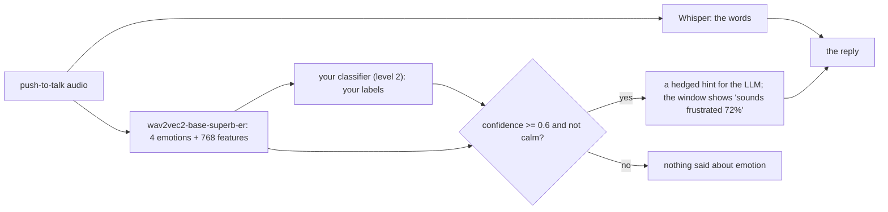

# Your emotion model

Jarvis hears *what* you say through Whisper, but the LLM only gets text: it
can't hear that you sound rushed or fed up. This milestone (M5) gives Jarvis
ears for *how* you sound, from the same push-to-talk audio, at the same
time as Whisper. The work is in perception: the LLM isn't retrained, it gets
a hedged hint ("they may sound frustrated (72%); ask, don't assume").

**Who does what:** the frame is ready and tested
(`src/jarvis/perception/emotion.py`): the ready-made model running beside
Whisper, the hint and its confidence gate, the window's "sounds" pill, `/mood`
labels, and the evaluation (`scripts/emotion_eval.py`). You collect your
labels, write `scripts/train_emotion_level2.py`, and measure it against the
baseline. That's the "improving on a pretrained model" part of the project.

## How it works



- **Level 1, the baseline (no training):** `superb/wav2vec2-base-superb-er`
  (Apache-2.0), wav2vec 2.0 base fine-tuned for emotion recognition on
  IEMOCAP, the most used emotion dataset: about 12 hours of *acted* American
  English, four labels (neutral, happy, angry, sad), about 63% accuracy there.
  Jarvis says them as calm, happy, upset, sad.
- **Level 2, yours:** keep the model frozen and train a small classifier on
  its features (its last layer averaged over time: 768 numbers per
  utterance), with labels an assistant needs: calm, rushed, frustrated,
  confused, tired, happy... The pretrained model doesn't even have
  "confused", and it learned from actors, not Sri Lankan English or Sinhala.

It never holds up a reply: if the guess isn't ready half a second after
Whisper, the reply goes without it. If the model fails, Jarvis says so once
and carries on without it.

## Step 0: switch it on

In `config/settings.local.toml`:

```toml
[emotion]
enabled = true
```

Start Jarvis. The first start downloads the model (about 380 MB) and prints
"Emotion model ready on cuda (the ready-made model)". It needs about 400 MB
of the GPU; with Whisper and Kokoro there that's fine on the RTX 4050 (6 GB).
If memory is short, `device = "cpu"` (slower, about 0.3 s an utterance).

## Step 1: try the baseline

Talk normally, then a few times in a clearly fed-up voice. After each,
`/mood` shows what it heard; the window shows "sounds ..." when it's sure.
`logs/session-*.jsonl` has every `emotion` event (label, confidence, ms).
Notice where it's wrong: that's your motivation section.

## Step 2: collect your labels

After something you said, type `/mood <label>`: `calm`, `happy`, `rushed`,
`frustrated`, `confused`, `tired`, `sad`, `upset` or `excited`. It saves that
utterance's 768 features, the baseline's scores, your label and the session,
to `data/emotion/labels.jsonl` (gitignored; no audio, ever).

- Aim for at least 30 per label you want, over **at least 5 sessions** on
  different days (your voice changes with the day; the test must see that).
- Label honestly what you felt, not what you hoped it heard. Unsure? Don't
  label.
- Others' voices only with their written consent, and ask the supervisor
  whether a formal study needs ethics approval.

## Step 3: train level 2

Write `scripts/train_emotion_level2.py`. What it must do:

1. Read `data/emotion/labels.jsonl` (`jarvis.perception.emotion.read_labels`).
2. Choose test sessions: hold out the newest one or two **whole sessions**.
   Never split utterances of one session between train and test: they sound
   alike, and the score would flatter you.
3. Train a classifier with `predict_proba` on the training features: start
   with `make_pipeline(StandardScaler(), LogisticRegression(max_iter=2000,
   class_weight="balanced"))` (features have different scales; labels are
   uneven).
4. Pick its settings (C = 0.1, 1, 10) by **GroupKFold by session** on the
   training sessions only (`sklearn.model_selection.GroupKFold`,
   `groups=session`), scoring macro-F1.
5. Save with joblib to `models/emotion/emotion.joblib` a dict:
   `{"classifier": model, "trained_sessions": [...], "labels": [...],
   "trained": date, "cv_macro_f1": ...}`. Jarvis loads it at the next start
   and says "(your classifier)".

<details>
<summary>A skeleton to start from</summary>

```python
"""Level 2 emotion model: a classifier on wav2vec2's features, from my /mood labels."""
from datetime import date
from pathlib import Path

import joblib
import numpy as np
from sklearn.linear_model import LogisticRegression
from sklearn.model_selection import GroupKFold, cross_val_score
from sklearn.pipeline import make_pipeline
from sklearn.preprocessing import StandardScaler

from jarvis.perception.emotion import read_labels

ROOT = Path(__file__).resolve().parents[1]
rows = read_labels(ROOT / "data" / "emotion" / "labels.jsonl")
sessions = sorted({r["session"] for r in rows}, key=lambda s: min(r["time"] for r in rows if r["session"] == s))
test_sessions = set(sessions[-1:])                      # the newest session: never seen in training
train = [r for r in rows if r["session"] not in test_sessions]
X = np.array([r["features"] for r in train])
y = [r["label"] for r in train]
groups = [r["session"] for r in train]

# TODO: for C in (0.1, 1, 10): cross_val_score(..., cv=GroupKFold(n_splits=...), groups=groups,
#       scoring="f1_macro"); keep the best C
# TODO: fit the pipeline with the best C on all of train
# TODO: joblib.dump({...}, ROOT / "models" / "emotion" / "emotion.joblib") with "trained_sessions"
```
</details>

## Step 4: measure it against the baseline

```
uv run python scripts/emotion_eval.py                                 # the baseline on your labels
uv run python scripts/emotion_eval.py models/emotion/emotion.joblib   # yours, on sessions it didn't train on
```

It prints and writes `docs/emotion_results.md`: accuracy, **macro-F1**
(every label counts the same, however rare), F1 per label, and the **false
alarm rate**: how often Jarvis would hint at an emotion when you were calm.
That last one matters most for how Jarvis feels to use: a wrong "you sound
upset" is worse than saying nothing.

The baseline counts as right when its label is the nearest one (upset for
frustrated, sad for tired, happy for excited); it can never be right on
rushed or confused.

## Step 5: choose the gate

`[emotion] min_confidence` (0.6) decides when a guess becomes a hint. From
the report's decision theory: hint only when p > C_FA / (C_FA + C_FN), where
C_FA is the cost of a false "you sound upset" and C_FN the cost of missing
it. If a false alarm is three times as bad as a miss, that's 0.75. Run the
evaluation at 0.5, 0.6, 0.75 (`--min-confidence`) and show the trade-off
between false alarms and missed emotions.

## Step 6 (optional): what else could help

- **Words and voice together:** the text ("this is so annoying") and the
  voice disagree sometimes; a classifier on both (the features + a few word
  signals) is the "fused" step of the roadmap.
- **Emotion as context for the empathy learner:** pass the label as
  `Feedback.context` so the bandit learns a mode per state
  (docs/TRAINING_EMPATHY.md, step 5.3).
- **Another frozen model:** `emotion2vec` features instead of wav2vec2's,
  same classifier, same evaluation: does a better encoder beat more labels?

## What to report

- The baseline on your voice (step 1-2), honestly, including where it fails.
- Level 2 against it on held-out sessions: macro-F1, F1 per label, false
  alarms, with how many labels and sessions it learned from.
- The gate trade-off (step 5).
- Limits: one speaker (you), self-labels (what you felt is subjective), a
  small set; it's a personal model, not a general one.

## Learn

- Baevski et al., *wav2vec 2.0* (NeurIPS 2020): what the frozen features are.
- Yang et al., *SUPERB: Speech processing Universal PERformance Benchmark*
  (Interspeech 2021): where the baseline comes from, and its ER task.
- Busso et al., *IEMOCAP* (2008): what the baseline learned from, and why it's
  acted.
