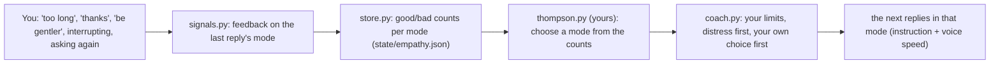

# Your empathy learner

Jarvis has three empathy modes (`config/persona.toml`): **logical** (brief,
facts), **balanced** (a word of acknowledgement, then help) and
**supportive** (feelings first, slower voice, a choice of how to go on).
Which one suits you isn't something to guess: Jarvis can learn it from what
you tell him anyway. Your part is the learner: about 15 lines, the core of
milestone M2.

**Who does what:** the frame is ready and tested (`src/jarvis/empathy/`):
what counts as feedback, the counts, when Jarvis chooses, your limits, the
distress override, the simulator and the checks for your code. You write
`src/jarvis/empathy/thompson.py`, test it, measure it, and switch it on.

## How it works in Jarvis



| What you do after a reply | Counts as | Weight |
|---|---|---|
| "thanks", "that helped", "ස්තූතියි", "niyamai" (short) | good | 1 |
| "too long", "get to the point", "that's not what I asked" | bad | 1 |
| "be more direct" / "be gentler" (a mode command) | bad for the mode you were in | 1 |
| asking nearly the same thing again within 2 minutes | bad | 0.8 |
| pressing push-to-talk while Jarvis is still answering | bad | 0.5 |

Only counts are kept (`state/empathy.json`), plus a log of each signal
(`state/empathy-log.jsonl`), never your words. `/empathy stats` shows them.
Jarvis chooses again after feedback, or every 5 replies (`[empathy]
rechoose_every`), so the style doesn't flicker. A mode you ask for stays for
the session; real distress always gets the supportive mode.

## The idea: a three-armed bandit

Each mode is an "arm" of a slot machine. Pulling it (answering in that mode)
pays out good feedback with some unknown probability θ. You want to pull the
best arm as often as possible while still learning which one is best: the
**explore-exploit** trade-off.

**What Jarvis believes about θ.** Start knowing nothing: θ could be anything
from 0 to 1 equally (a uniform prior, which is Beta(1, 1)). After `g` good
and `b` bad, Bayes' rule gives the posterior

    θ | data ~ Beta(g + 1, b + 1)        mean (g + 1) / (g + b + 2)

because the Beta distribution is conjugate to the Bernoulli: the posterior is
again a Beta, and updating is just counting. Weighted, fractional counts
(0.5 for an interruption) work the same way.

**Thompson sampling.** To choose: draw one sample θ̃ from each mode's
posterior, and pick the mode with the largest sample. A mode with little
data has a wide posterior, so it sometimes draws high and gets tried
(exploration); a mode that's clearly good draws high nearly every time
(exploitation). No tuning knob, unlike ε-greedy's ε.

**Regret** (how the simulator measures it): after T replies,
`Σ (θ_best − θ_chosen)`. Thompson sampling's regret grows like log T (it
stops paying for exploration once it's sure); a fixed or random choice grows
linearly.

## Step 1: write it

Create `src/jarvis/empathy/thompson.py` with a class `ThompsonLearner`:

- a `name` attribute (a string, e.g. `"thompson"`), shown in `/empathy stats`
  and the simulator's table;
- a method `choose(self, modes, counts, rng)` that returns one of `modes`:
  - `modes`: the modes allowed now, e.g. `["logical", "balanced", "supportive"]`;
  - `counts`: `{mode: (good, bad)}`, floats; a mode never tried isn't in it;
  - `rng`: a `random.Random`. Draw only from it (the tests and the simulator
    seed it, so results repeat).

Hints: `rng.betavariate(alpha, beta)` draws from Beta(α, β);
`counts.get(mode, (0.0, 0.0))` handles untried modes; `max(modes, key=...)`
picks the largest.

<details>
<summary>Check your answer (after you've tried)</summary>

```python
class ThompsonLearner:
    name = "thompson"

    def choose(self, modes, counts, rng):
        def draw(mode):
            good, bad = counts.get(mode, (0.0, 0.0))
            return rng.betavariate(good + 1, bad + 1)      # a sample from the Beta(g+1, b+1) posterior
        return max(modes, key=draw)
```
</details>

## Step 2: test it

```
uv run pytest tests/test_empathy_yours.py -v
```

Five checks, skipped until your file exists: it only picks allowed modes,
tries every mode when there's no feedback, mostly picks the best when the
feedback is clear, still explores when unsure, and uses only the `rng` it's
given.

## Step 3: measure it on simulated users

```
uv run python scripts/simulate_empathy.py
```

Simulated users secretly prefer one mode (good feedback with probability
p[mode]). Your learner sees only the feedback, through the same counts
Jarvis keeps. It writes `docs/empathy_simulation.md` (regret after 300
replies, mean ± sd over 100 seeded runs) and `docs/empathy_simulation.svg`
(regret over time for the user who changes their mind), for your report.

What to expect (from a check run, 30 runs): fixed and random lose 75-90 of
300 for users with a clear preference; ε-greedy about 12; Thompson sampling
about 6-8. The **close-call** user (modes nearly equal) costs everyone a
little; **sparse** (feedback on only 30% of replies) learns slower; and
**changes-mind** (prefers logical, then supportive) is where plain Thompson
sampling struggles: old counts keep outvoting new ones.

## Step 4: switch it on

In `config/settings.local.toml`:

```toml
[empathy]
learner = "thompson"
```

Start Jarvis: `/empathy stats` shows `learner: thompson` and the counts
growing as you use him. `logs/session-*.jsonl` has every `empathy_feedback`
and `empathy_changed` (with `source: "learner"`, `"manual"` or
`"distress"`).

## Step 5: improve it (pick one or two, measure each)

1. **Forgetting (for changes-mind).** Discounted Thompson sampling: before
   using the counts, multiply them by γ^(age), or keep only the last N
   feedback events (`state/empathy-log.jsonl` has the times). Try γ = 0.95,
   0.98; the simulator shows the trade-off (forgetting costs a little on
   users who don't change).
2. **A prior from the default.** Start balanced at Beta(2, 1) instead of
   Beta(1, 1): Jarvis starts as before and moves away only on evidence.
3. **Context (with the emotion model).** Keep counts per emotional state
   (`Feedback.context`; `store.for_context("frustrated")`): you may like
   logical when calm and supportive when stressed. That's a contextual
   bandit.
4. **Implicit signals only.** How well does it learn from interruptions and
   repeats alone (no "thanks")? Set their weights in `signals.py`, simulate.

## What to report

- The simulator's table and plot: your learner against fixed, random and
  ε-greedy, with the spread over runs.
- One or two improvements, before and after.
- From real use: how many signals of each kind in a week, which mode it
  settled on, and whether that matched what you'd have chosen.
- Limits, honestly: feedback is sparse and noisy (a "thanks" may be about
  the content, not the style); an interruption isn't always a "no".

## Learn

- Russo, Van Roy et al., *A Tutorial on Thompson Sampling* (2018), chapters
  1-3: the Beta-Bernoulli bandit, exactly this case.
- Lattimore and Szepesvári, *Bandit Algorithms* (2020), chapter 36.
- Chapelle and Li, *An Empirical Evaluation of Thompson Sampling* (NIPS 2011).
