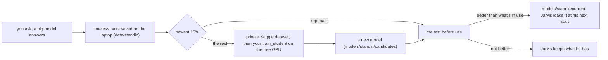

# Your stand-in model

When the internet is down or weak, Jarvis's language models (Groq, Gemini,
OpenRouter) can't answer, and Jarvis used to say only "I can't reach any
language model right now". This research part gives him a **stand-in**: a
small model of his own that has learned from the answers the big models gave
you before, answers instantly on the laptop, and says that it's doing so.
It doesn't replace the big models; it's what he falls back on.

**Who does what:** the frame is built and tested (`src/jarvis/standin/`,
`scripts/train_standin.py`, `kaggle/standin/train_standin.py`): saving the
conversations, version 1 (the lookup), answering when the models can't,
the runs on Kaggle's GPU, and the test before use. You write
`train_student()` (the training on Kaggle) and measure it against the
lookup. That's the "small student learning from a big teacher" part of the
project.

## How it works



- **What's saved:** your question and the model's answer, only when the
  answer stays true: a plain reply (no news, weather, PC action or MATLAB run)
  to a question that isn't about the time, today or the latest anything.
  Text only, never audio, in `data/standin/pairs.jsonl` (not in git).
- **Version 1, the lookup (no training):** the answer to the nearest past
  question, when it's the *same* question (multilingual-e5-small embeddings,
  cosine at least 0.9; or a TF-IDF of letters, at least 0.88, before e5 has
  downloaded). Typos and rewordings match; a different question doesn't.
- **Version 2, your student:** a small generative model fine-tuned on the
  pairs. It may answer questions *near* what it learned from (e5 cosine at
  least 0.85), not only the same ones. That's what training adds.
- **When it speaks:** when no model can be reached ("I can't reach the
  language models, so this is from what I said before."), or on a weak
  connection: no first word after 6 seconds (`[standin] after_s`) and a close
  match ("The connection's slow, so this is from my own small model.").
  Never passed off as the big model's answer.

## Step 0: switch it on

In `config/settings.local.toml` (already done on the laptop, 2 Nov):

```toml
[standin]
save = true          # keep the pairs
auto_train = true    # train on Kaggle when Jarvis closes, when there's enough new
```

At the start Jarvis prints "Stand-in ready: the lookup, over N saved answers
(e5)". The first start downloads multilingual-e5-small (about 470 MB, to D:,
the same encoder as your intent model's level 2); until then it uses the
TF-IDF lookup. `/standin` shows what it knows and the last Kaggle run.

## Step 1: talk

Use Jarvis normally. Explanations, maths, physics and chat are saved; news,
weather and the time aren't. You need about 200 pairs for a first student
(more is better: 500+).

## Step 2: check the pipeline (once)

```
scripts\train_standin.cmd --check
```

It uploads the pairs to a **private** Kaggle dataset
(`thilinabandara9876/jarvis-standin-pairs`), runs
`kaggle/standin/train_standin.py` on a private GPU notebook
(`jarvis-standin-training`) in check mode, and downloads the result. It ends
with "the pipeline works: N pairs reached the GPU (Tesla T4) and back". The
newest 15% of the pairs never leave the laptop.

## Step 3: write `train_student`

In `kaggle/standin/train_standin.py`. Its docstring says what goes in and what
must come out; in short:

1. Pick a small base model:
   - `google/flan-t5-small` (seq2seq, 77M parameters, English; quick on the
     laptop's CPU), or
   - `google/mt5-small` (seq2seq, Sinhala too, larger vocabulary), or
   - a small chat model (causal), such as `HuggingFaceTB/SmolLM2-135M-Instruct`.
2. Hold out the newest 10% of the uploaded pairs (by `time`) for validation.
3. Tokenize: the question is the input, the reply the target (cut replies at
   about 256 tokens).
4. Fine-tune with `Seq2SeqTrainer` (or `Trainer` for causal): a few epochs,
   learning rate about 3e-4 for T5 (5e-5 for a causal model), `fp16=True` on
   the GPU, `load_best_model_at_end=True` on the validation loss.
5. `model.save_pretrained(out_dir / "model")` and
   `tokenizer.save_pretrained(out_dir / "model")`.
6. Return the manifest: `{"kind": "seq2seq", "path": "model", "base":
   "google/flan-t5-small", "max_new_tokens": 160, "epochs": ..., "val_loss": ...}`.

<details>
<summary>A skeleton to start from</summary>

```python
def train_student(pairs, out_dir):
    from datasets import Dataset
    from transformers import (AutoModelForSeq2SeqLM, AutoTokenizer, DataCollatorForSeq2Seq,
                              Seq2SeqTrainer, Seq2SeqTrainingArguments)
    base = "google/flan-t5-small"
    pairs = sorted(pairs, key=lambda p: p["time"])
    cut = int(len(pairs) * 0.9)
    tok = AutoTokenizer.from_pretrained(base)
    model = AutoModelForSeq2SeqLM.from_pretrained(base)

    def encode(batch):
        x = tok(batch["question"], truncation=True, max_length=128)
        x["labels"] = tok(text_target=batch["reply"], truncation=True, max_length=256)["input_ids"]
        return x

    train = Dataset.from_list(pairs[:cut]).map(encode, batched=True)
    val = Dataset.from_list(pairs[cut:]).map(encode, batched=True)
    # TODO: Seq2SeqTrainingArguments(output_dir=..., num_train_epochs=..., learning_rate=...,
    #       per_device_train_batch_size=..., eval_strategy="epoch", save_strategy="epoch",
    #       load_best_model_at_end=True, fp16=True, report_to=[])
    # TODO: Seq2SeqTrainer(model, args, train_dataset=train, eval_dataset=val,
    #       data_collator=DataCollatorForSeq2Seq(tok, model)).train()
    # TODO: save the model and tokenizer to out_dir / "model"; return the manifest with the val loss
```
</details>

Try it first in a Kaggle notebook by hand if you like (attach the dataset
`jarvis-standin-pairs`, GPU on), then paste the function in.

## Step 4: train

```
scripts\train_standin.cmd
```

Or let Jarvis do it: with `auto_train = true`, when he closes and there are at
least 50 new pairs since the last run (`min_new_pairs`), at most once every 20
hours (`every_hours`; Kaggle's GPU hours are weekly), he starts the same run in
the background (its log in `logs/standin-*.log`). Until `train_student` is
written, automatic runs don't start, so no GPU time is wasted.

## Step 5: the test before use

Every run ends with the test, on the held-out pairs (the newest, never
uploaded). Each stand-in answers each held-out question, the way Jarvis would
(declining when it isn't close enough), and its answer is compared with what
the big model really said, by meaning (e5 cosine of the two answers):

- **coverage:** how often it answered;
- **quality:** how close its answers were, when it answered;
- **overall:** the mean over all questions, a declined one counting 0. This
  decides: the new model is used only if its overall beats what Jarvis uses
  now (the lookup, or your previous student) by at least 0.01.

`docs/standin_results.md` has the table. That's your results section.

## What to report

- Coverage, quality and overall for the lookup and your student, on held-out
  conversations, with how many pairs it learned from; and how they change as
  the pairs grow (each run is a point on that curve).
- Examples: a question the student answered well that the lookup couldn't
  (a rewording), and one where it made something up.
- Latency on the laptop's CPU (the stand-in's ms in `logs/session-*.jsonl`,
  event `standin_answer`) against the big models'.
- Limits: it can only know what you asked before; a small model can state
  wrong things confidently (the reason for the similarity gate and the spoken
  "this is from my own small model"); one user's conversations.

## Privacy

The pairs stay on the laptop, except the training part, which goes to a
private dataset in your Kaggle account (under Kaggle's terms). Never audio.
To delete: `data/standin/pairs.jsonl` here, and the dataset and notebook on
kaggle.com (Your Work).

## Learn

- Hinton, Vinyals, Dean, *Distilling the Knowledge in a Neural Network*
  (2015), [arXiv:1503.02531](https://arxiv.org/abs/1503.02531): the idea.
- Kim and Rush, *Sequence-Level Knowledge Distillation* (EMNLP 2016),
  [arXiv:1606.07947](https://arxiv.org/abs/1606.07947): training a small model
  on a big model's generated answers, as here.
- Wang et al., *Multilingual E5 Text Embeddings* (2024),
  [arXiv:2402.05672](https://arxiv.org/abs/2402.05672): the encoder behind the
  lookup, the gate and the test.
